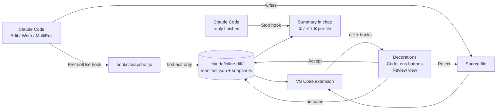

# Claude Inline Diff

[](https://github.com/jaafar-shiha/claude-inline-diff/actions/workflows/ci.yml)
[](LICENSE)


**Cursor-style inline review for [Claude Code](https://claude.com/claude-code) edits in VS Code.**

When Claude edits your code, every change shows up in the file itself: added lines are highlighted in green, removed code is marked in red, and each change has its own **Accept** and **Reject** buttons. You stay in your normal editor. There's no separate diff tab or chat panel to switch to.

The extension works with every Claude Code session on your machine: the VS Code extension, the terminal CLI and the Claude desktop app.

---

## Features

- **Inline highlighting.** Added lines get a green background. Removed lines are shown as red struck-through text, and hovering shows the full removed code.
- **Per-change review.** `✓ Accept` / `✗ Reject` buttons sit directly above each changed block. Accept keeps Claude's version; Reject restores your original lines in place.
- **File-level actions.** **Accept All**, **Reject All** and **Compare** (side-by-side diff against the pre-Claude version) at the top of every changed file.
- **End-of-reply checklist.** When Claude finishes a reply, the chat lists every file it edited in that conversation, so nothing slips through:
  ```
  Claude Inline Diff: 3 files edited in this chat
  ⏳ lib/home_screen.dart (waiting for review)
  ❌ lib/api_client.dart (rejected)
  ✅ lib/main_screen.dart (accepted)
  1 file still to review in VS Code.
  ```
  A file whose changes you partly kept and partly undid shows as `✅❌ partly accepted`.
- **Review queue.** A **Claude Changes** view in the Explorer and a status bar counter list every file waiting for review.
- **Keyboard-first.** Accept or reject the change under the cursor without touching the mouse.
- **Safe by design.** Rejecting a file that Claude created moves it to the trash rather than deleting it permanently, and destructive bulk actions ask for confirmation.

## How it works



1. **Capture.** A Claude Code [`PreToolUse` hook](https://docs.claude.com/en/docs/claude-code/hooks) runs right before Claude's file tools (`Edit`, `Write`, `MultiEdit`). The first time Claude touches a file, the hook saves a snapshot of it and records the file in a manifest. The hook always exits successfully, so it can never block Claude.
2. **Diff.** The extension watches the manifest and the edited files. It computes a line diff between each snapshot and the current text, then groups the result into *hunks*, which are runs of consecutive changes.
3. **Review.** Each hunk is rendered with editor decorations and CodeLens actions.
   - **Accepting** a hunk folds it into the snapshot, so that hunk becomes the new baseline.
   - **Rejecting** a hunk writes the original lines back into the file.
   - When the snapshot and the file match again, the file leaves the review queue.
4. **Summarize.** The same hook also runs on Claude Code's `Stop` event, when Claude finishes a reply.
   - It reads which files this chat edited, plus each file's review outcome, and returns the list as a message. Claude Code shows that message at the end of the reply.
   - It stays quiet after replies that edited nothing and left nothing to review.

The two sides share no process. They talk only through files in `<project>/.claude/inline-diff/`, which is git-ignored automatically. That is why edits from any Claude Code client show up in VS Code.

## Installation

### From a release

1. Download the latest `.vsix` from [Releases](https://github.com/jaafar-shiha/claude-inline-diff/releases).
2. In VS Code, open the Command Palette and run **Extensions: Install from VSIX…**.

### From source

```bash
git clone https://github.com/jaafar-shiha/claude-inline-diff.git
```

```bash
cd claude-inline-diff && npm install && npm run package
```

Then install the generated `claude-inline-diff-<version>.vsix` as above.

## Getting started

1. Open a project in VS Code. When asked *"Show Claude's edits … as inline diffs?"*, click **Set Up**. You can also run **Claude Diff: Set Up for This Workspace** from the Command Palette.
2. Start a **new** Claude Code session. Sessions that were already running don't pick up new hooks.
3. Ask Claude to change something. The file opens with the changes highlighted and ready for review.

Setup does two things:
- It registers the hook once in `~/.claude/settings.json`, for `PreToolUse` (file edits) and `Stop` (end of reply), so every Claude Code client uses it.
- It creates `.claude/inline-diff/` in the project. Only projects with this folder are tracked.

> **Tip:** For the full Cursor-like flow, set Claude Code's permission mode to **Edit automatically** (`acceptEdits`). Claude then applies edits directly, and you review them afterwards in the file instead of approving each one up front.

## Keyboard shortcuts

| Action                    | macOS | Windows / Linux      |
| ------------------------- | ----- | -------------------- |
| Accept change at cursor   | `⌥⌘Y` | `Ctrl+Alt+Y`         |
| Reject change at cursor   | `⌥⌘N` | `Ctrl+Alt+N`         |
| Accept all in file        | `⌥⌘↩` | `Ctrl+Alt+Enter`     |
| Reject all in file        | `⌥⌘⌫` | `Ctrl+Alt+Backspace` |

Shortcuts are active only while the focused file has pending changes.

## Configuration

| Setting                          | Default | Description                                                   |
| -------------------------------- | ------- | ------------------------------------------------------------- |
| `claudeInlineDiff.autoOpenFiles` | `true`  | Open each file in an editor tab as soon as Claude edits it.   |

## Design decisions

- **Snapshots instead of git.** Comparing against `HEAD` would mix Claude's edits with your own uncommitted work. A snapshot taken right before Claude's first edit isolates exactly what Claude changed. It also works in folders that aren't git repositories.
- **A hook instead of an editor integration.** Hooking into Claude Code's tool calls makes the extension independent of *where* Claude runs. The same flow covers the VS Code panel, the CLI and the desktop app.
- **Accept rewrites the baseline; Reject rewrites the file.** Both are pure functions over the same hunk list (`src/hunks.ts`), so partial review is just "rebuild the text, taking the new side for these hunks". That makes the review logic easy to unit-test.
- **Never block, never lose work.** The hook swallows its own errors and always exits 0. Manifest writes are atomic (write to a temp file, then rename). Deleting a Claude-created file goes to the system trash.

## Project structure

```
hooks/snapshot.js      Claude Code hook: snapshots files before the first edit (PreToolUse)
                       and lists edited files with their status when a reply ends (Stop)
src/extension.ts       VS Code integration: decorations, CodeLens, tree view, commands
src/hunks.ts           Pure diff/hunk logic: compute, accept, reject
src/store.ts           On-disk state, hook installation and migrations
src/test/              Unit tests (hunks) and integration tests run inside VS Code
```

## Development

```bash
npm install
```

```bash
npm run watch
```

Press **F5** in VS Code to launch an Extension Development Host with the extension loaded.

```bash
npm test
```

`npm test` compiles and lints the code, then runs the unit tests and the integration tests inside a real VS Code instance. The integration tests simulate a Claude edit through the actual hook and check that the Accept/Reject buttons appear and work. CI runs the same suite on every push.

## Limitations

- VS Code's API can't insert virtual lines into an editor, so removed code is shown as a one-line red hint with a hover, not as full red lines. **Compare** opens a classic side-by-side diff when you need the full picture.
- Only changes made through Claude's file-editing tools are tracked. Changes made through shell commands (for example `sed` or `rm`) are not.
- The end-of-reply list reflects the moment Claude finishes. Files edited in that reply are always ⏳ at first; once you review them, the next reply shows them as ✅ or ❌.
- Edits you make yourself to a file under review appear as part of the pending changes until you accept or reject them.

## Roadmap

- [ ] Publish to the VS Code Marketplace
- [ ] Show removed lines as full-width red blocks where the editor API allows it
- [ ] Group changes by Claude session or prompt
- [ ] Support for JetBrains IDEs (Android Studio, IntelliJ)

## Contributing

Issues and pull requests are welcome. Please run `npm test` before opening a PR.

## License

[MIT](LICENSE) © Jaafar Shiha
